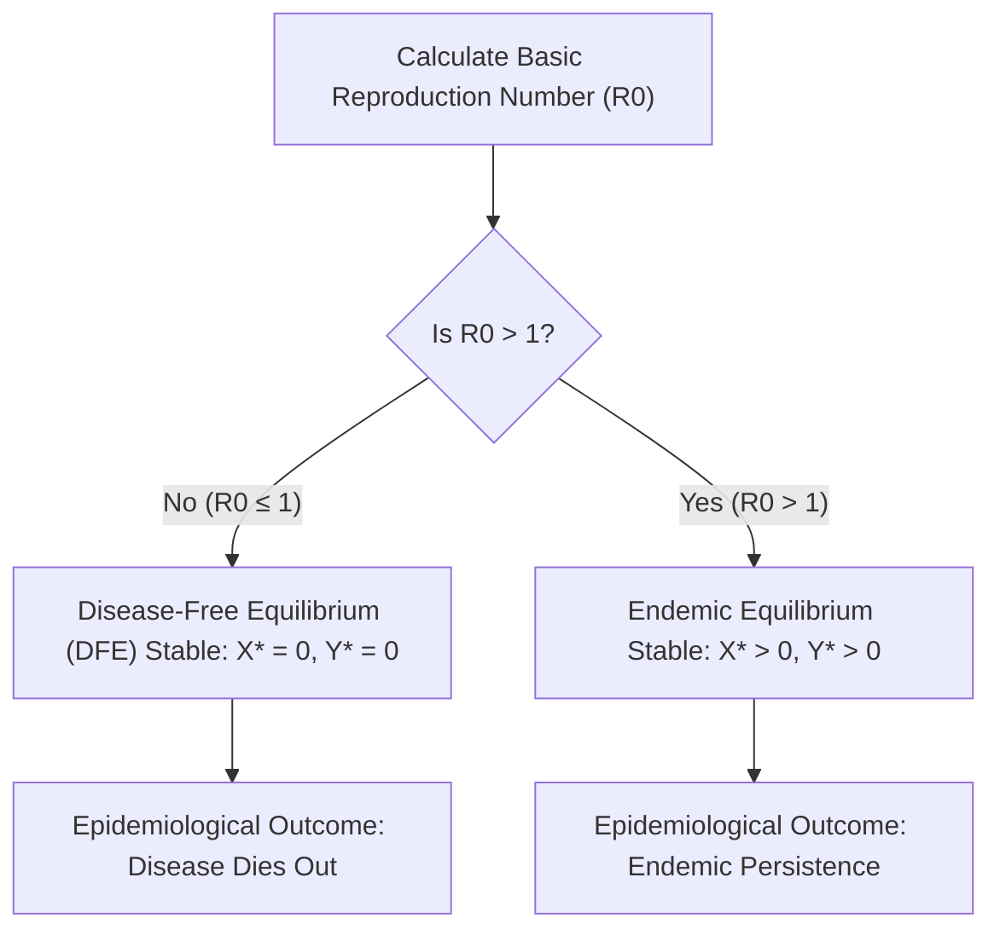

# Comprehensive Documentation: Ross-Macdonald Malaria Transmission Model

**Author / Maintainer:** Malaria Model Project  
**Implementation:** Standalone Single-File Architecture ([`malaria_model.py`](file:///c:/Programming/malaria-model/malaria_model.py))  
**Language:** Python 3.8+ (Standard Library Tkinter, NumPy, Matplotlib)

---

## Table of Contents
1. [Executive Summary](#1-executive-summary)
2. [Biological & Epidemiological Background](#2-biological--epidemiological-background)
3. [Mathematical Formulation](#3-mathematical-formulation)
   - [3.1 System Variables & Parameters](#31-system-variables--parameters)
   - [3.2 Governing Differential Equations](#32-governing-differential-equations)
   - [3.3 Derivation of the Basic Reproduction Number ($R_0$)](#33-derivation-of-the-basic-reproduction-number-r_0)
   - [3.4 Threshold Dynamics & Stability](#34-threshold-dynamics--stability)
   - [3.5 Theoretical Steady-State Equilibria ($X^*, Y^*$)](#35-theoretical-steady-state-equilibria-x-y)
   - [3.6 Vectorial Capacity ($C$)](#36-vectorial-capacity-c)
4. [Numerical Discretization Scheme](#4-numerical-discretization-scheme)
5. [Code Architecture & Module Breakdown](#5-code-architecture--module-breakdown)
   - [Section 1: Configuration & UI Theme](#section-1-configuration--ui-theme)
   - [Section 2: Mathematical Simulation Logic](#section-2-mathematical-simulation-logic)
   - [Section 3: Visualization & LaTeX MathText Rendering](#section-3-visualization--latex-mathtext-rendering)
   - [Section 4: Graphical User Interface (Tkinter)](#section-4-graphical-user-interface-tkinter)
   - [Section 5: Application Entry Point](#section-5-application-entry-point)
6. [User Interface & Operation Guide](#6-user-interface--operation-guide)
   - [6.1 Installation & Startup](#61-installation--startup)
   - [6.2 Input Parameter Reference Table](#62-input-parameter-reference-table)
   - [6.3 Reading the Unified Display Canvas](#63-reading-the-unified-display-canvas)
   - [6.4 Exporting LaTeX to Overleaf / Reports](#64-exporting-latex-to-overleaf--reports)
7. [Technical Notes & Matplotlib MathText Quirks](#7-technical-notes--matplotlib-mathtext-quirks)
8. [References](#8-references)

---

## 1. Executive Summary

This software implements the classic **Ross-Macdonald mathematical model** of malaria transmission. The tool allows researchers, students, and epidemiologists to:
1. Simulate host-vector infection trajectories dynamically across configurable durations.
2. Analytically evaluate the **Basic Reproduction Number ($R_0$)** and determine whether an outbreak persists endemically or dies out.
3. Inspect governing differential equations alongside step-by-step arithmetic substitutions rendered with native **LaTeX typography**.
4. Run without complex installations: the application is completely contained within a **single file** ([`malaria_model.py`](file:///c:/Programming/malaria-model/malaria_model.py)), relying strictly on Python's built-in `tkinter`, `numpy`, and `matplotlib`.

---

## 2. Biological & Epidemiological Background

Malaria is a vector-borne infectious disease caused by *Plasmodium* protozoan parasites transmitted exclusively through the bites of infectious female *Anopheles* mosquitoes:
- **Vector $\to$ Host:** An infectious mosquito bites a susceptible human, injecting sporozoites that migrate to the liver, mature, and infect erythrocytes.
- **Host $\to$ Vector:** An uninfected mosquito bites an infected human carrying circulating gametocytes, becoming infected and capable of transmitting the parasite after an extrinsic incubation period.

Sir Ronald Ross (1911) and George Macdonald (1957) formulated the mathematical basis of this reciprocal transmission cycle, proving that malaria eradication does not require killing every mosquito, but rather reducing mosquito density or longevity below a critical epidemiological threshold ($R_0 < 1$).

---

## 3. Mathematical Formulation

### 3.1 System Variables & Parameters

| Variable / Parameter | Mathematical Symbol | Unit | Default Value | Description |
| :--- | :---: | :---: | :---: | :--- |
| **Human Population** | $N$ | individuals | `1000` | Total human population (assumed constant over simulation timeframe) |
| **Mosquito Population** | $M$ | individuals | `5000` | Total female mosquito population |
| **Vector-to-Host Ratio** | $m = M / N$ | vectors/human | `5.00` | Average number of female mosquitoes per human |
| **Biting Rate** | $a$ | $\text{days}^{-1}$ | `0.25` | Average number of human bites per female mosquito per day |
| **Transmission Efficiency (M $\to$ H)** | $b$ | dimensionless | `0.30` | Probability that a bite from an infectious mosquito infects a human |
| **Transmission Efficiency (H $\to$ M)** | $c$ | dimensionless | `0.15` | Probability that a bite on an infectious human infects a mosquito |
| **Human Recovery Rate** | $r$ | $\text{days}^{-1}$ | `0.01` | Rate at which humans clear infection ($1/r = 100\text{ days}$ mean infectious duration) |
| **Mosquito Mortality Rate** | $\mu_m$ | $\text{days}^{-1}$ | `0.10` | Daily per-capita vector mortality rate ($1/\mu_m = 10\text{ days}$ mean vector lifespan) |
| **Infected Human Proportion** | $X(t)$ | dimensionless | Initial: `0.01` | Fraction of human population currently infected ($0 \le X \le 1$) |
| **Infected Mosquito Proportion** | $Y(t)$ | dimensionless | Initial: `0.00` | Fraction of female mosquito population currently infected ($0 \le Y \le 1$) |

---

### 3.2 Governing Differential Equations

The dynamics of human infection prevalence ($X$) and mosquito infection prevalence ($Y$) over time $t$ are governed by the coupled non-linear ordinary differential equations (ODEs):

$$\frac{dX}{dt} = \underbrace{m \cdot a \cdot b \cdot Y(t) \cdot (1 - X(t))}_{\text{New Human Infections}} - \underbrace{r \cdot X(t)}_{\text{Human Recovery}}$$

$$\frac{dY}{dt} = \underbrace{a \cdot c \cdot X(t) \cdot (1 - Y(t))}_{\text{New Mosquito Infections}} - \underbrace{\mu_m \cdot Y(t)}_{\text{Mosquito Mortality}}$$

#### Term Explanations:
1. **$m \cdot a$**: Total bites per human per day.
2. **$m \cdot a \cdot Y(t)$**: Infectious bites per human per day.
3. **$m \cdot a \cdot b \cdot Y(t) \cdot (1 - X(t))$**: Rate at which susceptible humans ($1 - X$) become infected per unit time.
4. **$r \cdot X(t)$**: Clearance rate of human infections due to host immunity or treatment.
5. **$a \cdot c \cdot X(t) \cdot (1 - Y(t))$**: Rate at which susceptible mosquitoes ($1 - Y$) bite infectious humans ($X$) and contract malaria.
6. **$\mu_m \cdot Y(t)$**: Rate at which infectious mosquitoes die.

---

### 3.3 Derivation of the Basic Reproduction Number ($R_0$)

The Basic Reproduction Number ($R_0$) is the average number of secondary human infections generated by a single infectious human introduced into a completely susceptible population ($X \approx 0, Y \approx 0$):

1. **Human to Mosquitoes:** An infected human remains infectious for an average duration of $1/r$ days.
   - During this period, mosquitoes bite the human at rate $m \cdot a$.
   - A proportion $c$ of bites transmits the parasite to mosquitoes.
   - Number of mosquitoes infected by one human:
     $$\text{Mosquitoes infected} = \frac{m \cdot a \cdot c}{r}$$

2. **Mosquito to Humans:** An infected mosquito lives for an average of $1/\mu_m$ days.
   - During its lifespan, it bites humans at daily rate $a$.
   - A proportion $b$ of bites transmits the parasite to humans.
   - Number of secondary humans infected per mosquito:
     $$\text{Humans infected} = \frac{a \cdot b}{\mu_m}$$

3. **Combined Ross-Macdonald Reproduction Number:**
   Multiplying both transmission phases yields the composite dimensionless number:
   $$R_0 = \left(\frac{m \cdot a \cdot c}{r}\right) \times \left(\frac{a \cdot b}{\mu_m}\right) = \frac{m \cdot a^2 \cdot b \cdot c}{r \cdot \mu_m}$$

> [!IMPORTANT]
> Notice that the biting rate $a$ appears as a squared term ($a^2$). Because a mosquito must bite **twice** to complete the cycle (once to acquire the parasite and once to transmit it), interventions that reduce biting frequency (such as insecticide-treated bed nets) have a quadratic impact on disease transmission.

---

### 3.4 Threshold Dynamics & Stability

The stability of the system depends strictly on the magnitude of $R_0$:



- **If $R_0 \leq 1$:** The Disease-Free Equilibrium (DFE) $(X^*, Y^*) = (0, 0)$ is globally asymptotically stable. Any introduced infection will naturally diminish to zero.
- **If $R_0 > 1$:** The DFE is unstable, and the system asymptotically converges toward a stable non-zero **Endemic Equilibrium**.

---

### 3.5 Theoretical Steady-State Equilibria ($X^*, Y^*$)

Setting $\frac{dX}{dt} = 0$ and $\frac{dY}{dt} = 0$ at steady state:

$$m \cdot a \cdot b \cdot Y^* \cdot (1 - X^*) = r \cdot X^*$$
$$a \cdot c \cdot X^* \cdot (1 - Y^*) = \mu_m \cdot Y^*$$

Solving the system yields the theoretical endemic fractions:

$$X^* = \frac{R_0 - 1}{R_0 + \frac{a \cdot b}{r}}$$

$$Y^* = \frac{a \cdot c \cdot X^*}{a \cdot c \cdot X^* + \mu_m}$$

For the default parameters ($R_0 = 14.0625, \frac{a \cdot b}{r} = 7.50$):
- $X^* = \frac{14.0625 - 1}{14.0625 + 7.50} = \frac{13.0625}{21.5625} \approx 60.58\%$
- $Y^* = \frac{0.25 \times 0.15 \times 0.6058}{(0.25 \times 0.15 \times 0.6058) + 0.10} \approx 18.51\%$

---

### 3.6 Vectorial Capacity ($C$)

Vectorial capacity is defined as the daily rate at which future inoculations arise from currently infected humans:

$$C = \frac{m \cdot a^2 \cdot b \cdot c}{\mu_m}$$

The relationship to $R_0$ is direct:
$$R_0 = \frac{C}{r}$$

---

## 4. Numerical Discretization Scheme

The differential system is integrated using forward finite difference approximations (Euler integration) with fixed step size $\Delta t = 1.0\text{ day}$:

$$X(t + \Delta t) = \text{clamp}\Big(X(t) + \big[m \cdot a \cdot b \cdot Y(t) \cdot (1 - X(t)) - r \cdot X(t)\big] \cdot \Delta t, \; 0, \; 1\Big)$$

$$Y(t + \Delta t) = \text{clamp}\Big(Y(t) + \big[a \cdot c \cdot X(t) \cdot (1 - Y(t)) - \mu_m \cdot Y(t)\big] \cdot \Delta t, \; 0, \; 1\Big)$$

Where $\text{clamp}(v, 0, 1) = \max(0, \min(1, v))$ guarantees conservation of valid demographic proportions throughout the integration horizon.

---

## 5. Code Architecture & Module Breakdown

The complete software resides inside [`malaria_model.py`](file:///c:/Programming/malaria-model/malaria_model.py), partitioned into 5 documented sections:

```
malaria_model.py
│
├── SECTION 1: Configuration & Constants
│   ├── Window geometry (940x940), colors (pure white #FFFFFF, #111827 text)
│   ├── MODEL_FIELDS definitions (labels, defaults, dictionary keys)
│   └── Numerical step parameters (TIME_STEP = 1.0, initial ratios)
│
├── SECTION 2: Mathematical Model & Simulation Logic
│   ├── Dataclasses: SimulationParameters & SimulationResult
│   ├── calculate_r0(): Closed-form R0 calculation
│   └── simulate_transmission(): Discretized ODE integration & LaTeX string creation
│
├── SECTION 3: Visualization & LaTeX Rendering
│   └── create_unified_figure(): Unified Matplotlib canvas (Plot on top, LaTeX card below)
│
├── SECTION 4: Graphical User Interface (Tkinter)
│   ├── MalariaModelApp class
│   ├── _build_header(), _build_input_panel(), _build_action_bar()
│   ├── _build_kpi_banner(), _build_canvas_panel()
│   ├── copy_latex_code(): Clipboard export handler
│   └── run_model(): Validation, integration, and canvas re-rendering
│
└── SECTION 5: Application Entry Point
    └── main(): Tkinter event loop initialization
```

---

## 6. User Interface & Operation Guide

### 6.1 Installation & Startup

```bash
# Clone or navigate to the repository
cd c:\Programming\malaria-model

# Install dependencies
pip install numpy matplotlib

# Launch the application
python malaria_model.py
```

### 6.2 Input Parameter Reference Table

| UI Field Name | Key | Type | Valid Range | Standard Value | Practical Impact |
| :--- | :---: | :---: | :---: | :---: | :--- |
| **Human Population (N)** | `N` | Float | $> 0$ | `1000` | Scales vector-to-host ratio $m = M/N$. |
| **Mosquito Population (M)** | `M` | Float | $> 0$ | `5000` | Directly increases $m$ and $R_0$. |
| **Biting Rate (a)** | `a` | Float | $0 < a \le 2$ | `0.25` | Quadradic effect on $R_0$. Target of bed net interventions. |
| **Trans. Prob: M -> H (b)** | `b` | Float | $0 < b \le 1$ | `0.30` | Vector competence transmitting sporozoites. |
| **Trans. Prob: H -> M (c)** | `c` | Float | $0 < c \le 1$ | `0.15` | Parasite infectivity to mosquitoes. Target of transmission-blocking vaccines. |
| **Human Recovery (r)** | `r` | Float | $0 < r \le 1$ | `0.01` | Therapeutic target: antimalarial treatment accelerates $r$. |
| **Mosquito Mortality (μ_m)** | `mu_m` | Float | $0 < \mu_m \le 1$ | `0.10` | Vector control target: indoor residual spraying (IRS) increases $\mu_m$. |
| **Duration (Days)** | `days` | Int | $\ge 1$ | `180` | Horizontal time axis for simulation dynamics. |

---

### 6.3 Reading the Unified Display Canvas

The main visualization panel presents the entire epidemiological state without requiring tab switching:

```
┌────────────────────────────────────────────────────────────────────────┐
│                   Malaria Transmission Dynamics over 180 Days          │
│   100 ┌────────────────────────────────────────────────────────────┐   │
│       │                                 Infected Humans (%) [Red]  │   │
│    50 │               ----------------- Infected Mosquitoes [Blue] │   │
│       │            --                                              │   │
│     0 └────────────────────────────────────────────────────────────┘   │
│       0                             Time (Days)                   180  │
├────────────────────────────────────────────────────────────────────────┤
│ 1. Model Inputs Provided:                                              │
│    N = 1000,  M = 5000,  a = 0.25,  b = 0.30,  c = 0.15, ...           │
│                                                                        │
│ 2. Governing Ross-Macdonald Differential Equations:                    │
│    dX/dt = m · a · b · Y(1 - X) - r · X    dY/dt = a · c · X(1 - Y) - μY│
│                                                                        │
│ 3. Basic Reproduction Number (R0) & Substituted Analytical Solution:   │
│    m = 5000/1000 = 5.00                                                │
│    R0 = (5.00 × 0.25² × 0.30 × 0.15) / (0.01 × 0.10) = 14.0625        │
│                                                                        │
│ 4. Epidemiological Outcome & Theoretical Steady-State:                 │
│    R0 = 14.0625 > 1 (Endemic Persistence)  ==>  X* = 60.6%, Y* = 18.5% │
└────────────────────────────────────────────────────────────────────────┘
```

---

### 6.4 Exporting LaTeX to Overleaf / Reports

Clicking the **`📋 Copy LaTeX Code`** button in the action bar copies the exact publication-ready equations with your substituted values directly to your system clipboard.

**Example Copied Output:**
```latex
% ==========================================================
% Ross-Macdonald Malaria Model: Formulas & Substituted Solution
% ==========================================================

% 1. Model Inputs Provided:
% N = 1000, M = 5000, a = 0.25, b = 0.30, c = 0.15, r = 0.01, mu_m = 0.10, Days = 180

% 2. Governing Differential Equations:
\begin{aligned}
\frac{dX}{dt} &= m \cdot a \cdot b \cdot Y(t)\,(1 - X(t)) - r \cdot X(t) \\[6pt]
\frac{dY}{dt} &= a \cdot c \cdot X(t)\,(1 - Y(t)) - \mu_m \cdot Y(t)
\end{aligned}

% 3. Mosquito-to-Human Population Ratio:
m = \frac{M}{N} = \frac{5000}{1000} = 5.0000

% 4. Basic Reproduction Number (R_0) & Analytical Evaluation:
\begin{aligned}
R_0 &= \frac{m \cdot a^2 \cdot b \cdot c}{r \cdot \mu_m} \\[6pt]
    &= \frac{5.0000 \times (0.25)^2 \times 0.30 \times 0.15}{0.01 \times 0.10} \\[6pt]
    &= \frac{0.0140625}{0.0010000} \\[6pt]
    &= 14.0625 \quad \left(R_0 > 1 \implies \text{Endemic Persistence}\right)
\end{aligned}

% 5. Theoretical Steady-State Equilibrium:
\begin{aligned}
X^* &= \frac{R_0 - 1}{R_0 + \frac{a \cdot b}{r}} = 0.6058 \quad (60.58\%) \\[6pt]
Y^* &= \frac{a \cdot c \cdot X^*}{a \cdot c \cdot X^* + \mu_m} = 0.1851 \quad (18.51\%)
\end{aligned}
```

---

## 7. Technical Notes & Matplotlib MathText Quirks

1. **MathText Syntax Standard (`\leq` vs `\le`):**
   - Matplotlib's native MathText parser (`matplotlib._mathtext_data.tex2uni`) does **not** register `\le` as a valid TeX glyph.
   - Always use **`\leq`** for "less than or equal to" ($\le$) and **`\geq`** for "greater than or equal to" ($\ge$) inside MathText strings.
2. **Text Blocks in Formula Cards:**
   - Plain text headings inside the formula axes use standard `ax.text(..., fontweight='bold')` parameters rather than `\textbf{}` or `\mathbf{}` to avoid MathText grammar parse errors.
3. **Memory Management:**
   - When switching or recalculating models, `self.fig_canvas.get_tk_widget().destroy()` and `plt.close(self.current_fig)` are called explicitly to avoid memory leaks across long sessions.

---

## 8. References

1. **Ross, R.** (1911). *The Prevention of Malaria* (2nd ed.). London: John Murray.
2. **Macdonald, G.** (1957). *The Epidemiology and Control of Malaria*. London: Oxford University Press.
3. **Gordon, D., & Guilfoos, T.** (2020). *Mathematical Modeling for Epidemics*, Chapter 14: Ross-Macdonald Malaria Dynamics.
4. **Aron, J. L., & May, R. M.** (1982). *The population dynamics of malaria*. The Population Dynamics of Infectious Diseases: Theory and Applications, 139-179.
5. **Smith, D. L., et al.** (2012). *Ross, Macdonald, and a Theory for the Dynamics and Control of Mosquito-Transmitted Pathogens*. PLoS Pathogens, 8(4), e1002640.
